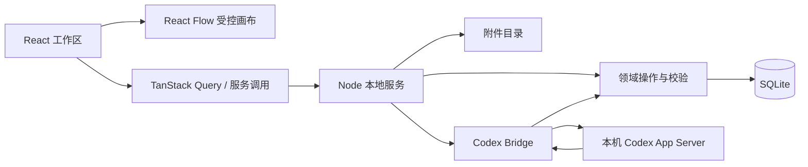

# 系统架构

## 已确定技术栈

React、TypeScript、TanStack Start / Router / Query、React Flow（`@xyflow/react`）、Node.js、SQLite、本地附件目录。包版本和具体数据库驱动在初始化时验证并锁定。

## 模块边界

拟定模块按职责划分：项目、画布、对话、spec、附件、AI、存储、认证适配。客户端仅导入可序列化 DTO 和纯逻辑；数据库、文件系统、子进程和 Codex bridge 限定在服务端模块。

所有持久化内容修改经过领域操作服务，手动操作和 AI 操作共用校验、事务及修订规则。AI 没有数据库或文件系统的直接写权限。

TanStack Router 管理页面与项目参数；Query 管理服务端快照、请求和失效刷新。画布交互中的临时位置、选择和编辑草稿由本地 UI 状态管理，不能为每个指针事件触发网络请求。

## React Flow 集成

使用受控 nodes/edges、自定义 nodeTypes 和 edgeTypes。领域模型与 React Flow 模型之间使用显式转换，数据库不存储组件、回调或 React Flow 内部对象。

`onNodesChange` / `onEdgesChange` 的变更先分类：选择和测量是 UI 状态；拖动为临时交互，结束时提交；删除、连线和内容编辑转换为领域操作。不能将所有变化直接整体覆盖数据库。

卡片内容与 handle 由自定义节点渲染；避免文本输入触发拖动和平移。连线创建验证同项目、端点存在且不自连；MVP 允许环，不引入 DAG 限制。重复的相同端点及标签连线默认拒绝。

位置由应用控制，新增内容采用简单避让；全局布局是显式命令。React Flow 的交互更新与服务端修订协调，收到过期响应不能覆盖较新的草稿。视口按项目保存在本机，不进入 AI 内容操作历史。

## 本地服务与存储

服务只监听 loopback，浏览器同源访问。SQLite 是权威存储，附件按 ID 映射到应用目录内的相对路径。数据库和附件不放源码目录。需要配置数据目录并展示有效位置，便于本机备份。

AI 文本与操作结果采用可恢复的 SSE 事件流；启动、取消和编辑使用服务端接口。断线不等于任务已取消，客户端重连先读取运行状态，再按事件序号补齐。请求中断或读取方取消时关闭本条 SSE 传输、移除中断监听并清理轮询定时器，保留后台任务与已持久化事件。

## 一致性与生命周期

项目内容有修订号，对象和 spec 也有独立修订号。AI 读取的是冻结快照，写入时比较目标修订；冲突返回当前状态，不盲目重放覆盖。每个操作批次原子提交并留逆操作。

服务退出时停止活跃任务并清理子进程。启动时将遗留 running 状态改为 interrupted，不自动恢复推理。删除有活跃任务的项目时先停止任务，再删除数据。

## 待验证

TanStack Start 的 Node 服务入口和流式连接生命周期、本机 Codex 协议、React Flow 性能基线及附件限制。以上不影响已经确认的产品边界。
